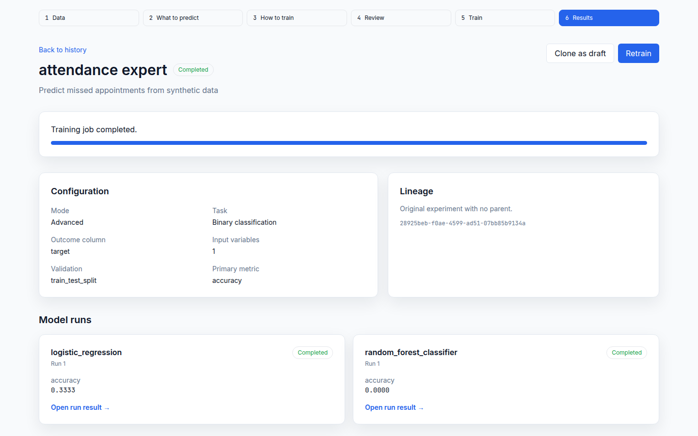
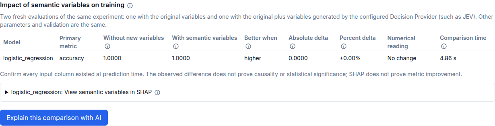

# ML Advisor

Local-first, open-source assistant for supervised machine-learning experiments on tabular CSV data. It profiles datasets, creates reproducible experiment specifications, trains and compares multiple models, tunes hyperparameters, and keeps artifacts and history on your machine.

> Pre-release: interfaces and saved artifacts may change before the first stable tag. Current checks and publication blockers are recorded in the release readiness report.

See the [public release readiness report](docs/public-release-readiness.md) before publishing a repository snapshot.

## What is included

- Automatic, AI-guided, and advanced workflows with a shared, validated `ExperimentSpec`.
- Binary and multiclass classification plus regression.
- Scikit-learn, XGBoost, CatBoost, and LightGBM adapters.
- Optuna tuning, live progress over SSE, metrics, Plotly charts, and SHAP analysis.
- Portuguese and English UI; OpenRouter, Ollama, and vLLM Advisor providers.
- SQLite history managed by Flyway and immutable local artifacts.
- AI Decisions with TypeSafe/OpenRouter Jev adapters, zero-shot metrics and calibration.
- Reviewed semantic feature generation, controlled baseline comparison, and confidence cascades.
- Opt-in local TF-IDF for free text, fitted inside each training fold; three-arm comparisons when JEV uses eligible text.

## Quick start

Requirements: Docker with Compose 2.24.4 or newer and GNU Make. The E2E configuration uses Compose's `!override` tag. No host Python or Node.js is required for the main stack; browser tests additionally use host Node.js/npm and Chrome or Playwright Chromium.

```bash
git clone https://github.com/flavio-crisler/ml-advisor.git
cd ml-advisor
make setup
make up
```

Open [http://localhost:8080](http://localhost:8080). API documentation is at [http://localhost:8000/api/docs](http://localhost:8000/api/docs). `make setup` creates local data directories and only creates `.env` when it is missing.

Advanced mode works without an LLM. For automatic or AI-guided mode, configure one provider in `.env`; see [LLM providers](docs/llm-providers.md).

If a default port is occupied, set `BACKEND_PORT` and `FRONTEND_PORT` in `.env`, for example 18000 and 18080, then use those ports in the URLs. See [configuration](docs/configuration.md) and [Docker operations](docs/docker.md) for development, backups, and diagnostics.

## Typical workflow

1. Import a CSV and review inferred types, target candidates, identifiers, and warnings.
2. Choose automatic, AI-guided, or advanced mode.
3. Review the target, features, preprocessing, validation, metrics, models, and tuning.
4. Train and follow live progress.
5. Compare model runs, inspect charts and SHAP, then clone to change the pipeline or parameters.

Column types and roles are heuristic suggestions. Free text is accepted with explicit TF-IDF preprocessing, not passed raw to tabular estimators; advanced users can opt short categorical-looking text into TF-IDF. Incompatible configurations are rejected before training starts. See [preprocessing rules](docs/preprocessing.md).

Decision workflows are under **AI Decisions**. Enable and configure exactly one `DECISION_*`
provider, then run a labeled zero-shot benchmark, generate reviewed semantic features from selected
text columns, or simulate a cascade from persisted benchmark probabilities. External processing
requires an explicit acknowledgement and stays disabled by default.

## Product preview

These captures use synthetic fixtures and mock providers; the measured results illustrate the workflow, not model quality on real data.





[Watch the dataset-to-results demo](docs/assets/ml-advisor-demo.webm) or the [baseline-to-semantic-impact demo](docs/assets/ml-advisor-semantic-demo.webm). Additional screen captures are in [`docs/assets/screenshots/`](docs/assets/screenshots/).
The [visual asset guide](docs/visual-assets.md) explains how to regenerate them with isolated synthetic data.

## Development and quality

```bash
make dev           # hot-reload backend and frontend
make test          # backend and frontend suites
make test-e2e      # clean Docker stack, browser workflows, restart, persistence
make smoke         # short browser navigation and API-health checks
make docs-visuals  # reproducible screenshots and demo recording
make test-decision # Decision Provider, benchmark, calibration, and cascade suites
make test-semantic # semantic proposal, generation, impact, and UI suites
make lint          # Ruff, ESLint, and Prettier checks
make build         # production images
make generate-client
```

Run `make help` for every target. Python 3.12/pip and Node.js 22/npm are used inside containers. See [CONTRIBUTING.md](CONTRIBUTING.md) for local contribution rules.
For browser commands, install a local Chrome browser or run `cd frontend && npx playwright install chromium` and invoke Make with `PLAYWRIGHT_CHANNEL=''`.

## Repository map

- `backend/app/`: API, application services, domain contracts, ML engine, providers, and infrastructure.
- `backend/migrations/`: Flyway-only SQLite migrations.
- `backend/prompts/`: versioned `pt-BR` and `en-US` Advisor prompts.
- `frontend/src/`: React/Vite SPA, feature screens, UI primitives, and locale resources.
- `data/`: ignored datasets, SQLite database, and experiment artifacts.
- `docs/`: architecture and extension guides; `examples/`: sample contracts.

## Data and security

Authentication is intentionally disabled for this single-user MVP. Compose binds published ports to `127.0.0.1` by default; do not expose them to untrusted networks. CSV rows are not sent to an LLM unless `LLM_SEND_SAMPLE=true`; profiles and objectives are sent in automatic and AI-guided modes. Never commit `.env`, API keys, uploaded data, databases, or artifacts.

Dataset profiles can include observed category values even with row sampling disabled. Decision benchmarks and semantic generation send selected cell values to the configured Decision Provider after acknowledgement; `LLM_SEND_SAMPLE` controls sampling in Advisor and semantic-question proposals, and does not disable those Decision Provider calls. See the [data-sharing table](docs/configuration.md#data-sent-to-providers) before using sensitive data.

## Documentation

Start with the [documentation index](docs/index.md), including [configuration](docs/configuration.md), [results and AI improvements](docs/results-and-improvements.md), architecture, API contracts, extension guides, and known limitations. Contribution rules are in [CONTRIBUTING.md](CONTRIBUTING.md), vulnerability reporting in [SECURITY.md](SECURITY.md), and the source license in [LICENSE](LICENSE). Fixture provenance is documented separately in [KAGGLE_SOURCES.md](backend/tests/fixtures/KAGGLE_SOURCES.md).
